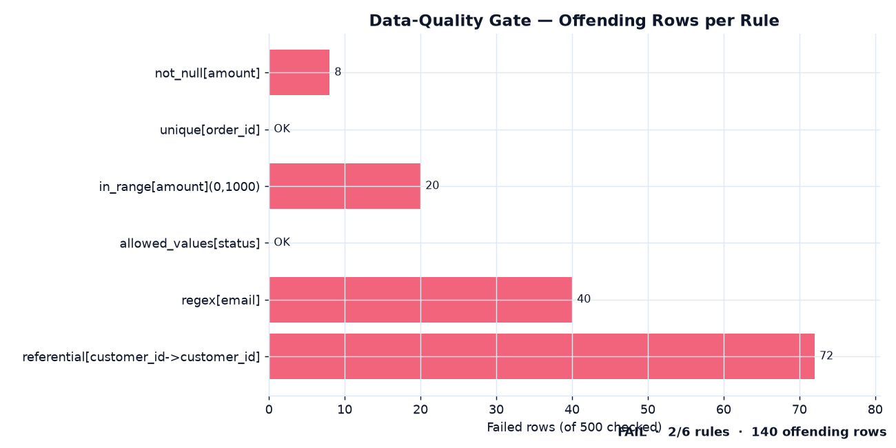

# 🧪 Data-Quality Framework

> A small, dependency-light **rule engine** for validating pandas DataFrames —
> the fail-fast data-quality gate I put in front of BI models and warehouse
> loads. Chainable expectations, a structured pass/fail report with
> offending-row counts, and JSON output for CI.

<p>
  
  
  
  
  
</p>

---

## 📊 The gate in action

`example.py` validates a 500-row `orders` feed against a `customers` dimension.
Two dimensions come back clean; four rules catch **140 offending rows** before
they reach a report:



---

## Why this project

Bad numbers in a dashboard cost more than no dashboard — they burn trust that
takes months to rebuild. The cheapest place to stop a data defect is at
ingestion, so this is the gate: a handful of declarative expectations that run
in milliseconds, fail loudly, and name the exact rows that broke each rule. The
same idea as Great Expectations, kept small enough to read in one sitting and to
drop into any pipeline with a single import — including the **referential
integrity** check that catches the broken joins row-level validators miss.

## Expectations

| Rule | Catches | Signature |
|---|---|---|
| `not_null` | Missing values | `.not_null(col)` |
| `unique` | Duplicate keys | `.unique(col)` |
| `in_range` | Out-of-bounds numerics (inclusive) | `.in_range(col, low, high)` |
| `allowed_values` | Off-list categoricals | `.allowed_values(col, {...})` |
| `matches_regex` | Malformed strings (emails, IDs) | `.matches_regex(col, pattern)` |
| `referential` | Orphaned foreign keys / broken joins | `.referential(col, ref_df, ref_col)` |
| `custom` | Anything else (row-level predicate) | `.custom(name, fn)` |

Nulls are treated as failures for range, regex and referential checks — an
unresolved value is a defect, not a free pass.

## Usage

The API is fluent and chainable; each expectation returns the suite, so a whole
contract reads top-to-bottom:

```python
from dq import Suite

suite = (Suite(orders)
         .not_null("amount")
         .unique("order_id")
         .in_range("amount", 0, 1000)
         .allowed_values("status", {"paid", "refunded", "pending"})
         .matches_regex("email", r"[^@\s]+@[^@\s]+\.[^@\s]+")
         .referential("customer_id", customers, "customer_id"))

print(suite.report())          # human-readable
suite.to_json()                # machine-readable (summary + per-rule)
assert suite.passed            # use as a CI/pipeline gate
```

## 📋 Results (latest demo run)

Validation of the seeded 500-row `orders` feed:

| Rule | Result | Failed rows | Fail rate |
|---|---|---|---|
| `not_null[amount]` | ❌ FAIL | 8 | 1.6% |
| `unique[order_id]` | ✅ PASS | 0 | 0.0% |
| `in_range[amount](0,1000)` | ❌ FAIL | 20 | 4.0% |
| `allowed_values[status]` | ✅ PASS | 0 | 0.0% |
| `regex[email]` | ❌ FAIL | 40 | 8.0% |
| `referential[customer_id]` | ❌ FAIL | 72 | 14.4% |
| **Overall** | **❌ FAIL** | **140 / 500** | 2/6 rules pass |

> Full report: [`docs/report.json`](docs/report.json) ·
> [`docs/report.txt`](docs/report.txt). Deterministic (seeded) — re-running
> reproduces these counts exactly.

## Methodology

Each expectation compiles to a boolean **failure mask** over the DataFrame; the
engine counts `mask.sum()` offending rows and marks the rule passed only at
zero. Because every rule shares that contract, the suite composes trivially:
chaining builds a list of `Result` records, `summary()` rolls them up (rule
counts, total offending rows, pass rate), and `report()` / `to_json()` render
the same state for humans and machines. `referential` accepts an iterable, a
`Series`, or a `(DataFrame, column)` pair and checks membership against the
dimension's key set. No config files, no I/O in the core — just pandas.

## ▶️ Run it

```bash
pip install -r requirements.txt
python example.py     # prints the report, writes outputs/ (report.json + chart)
pytest -q             # 15 tests
```

## 🧪 Tests

`tests/test_engine.py` tests **every rule on crafted data with a known number of
violations** — inclusive range bounds, full-match (not partial) regex, nulls
counted as orphans in referential checks, duplicate-beyond-first semantics for
uniqueness — plus the roll-up: `summary()` math, `report()` rendering, and
JSON serialisability.

## 🗂️ Project structure

```
data-quality-framework/
├── dq/
│   ├── __init__.py
│   └── engine.py          # Suite + Result: the rule engine
├── tests/
│   └── test_engine.py     # 15 per-rule pytest cases
├── example.py             # end-to-end demo + house-style report chart
├── docs/                  # committed report chart + JSON/text snapshot
├── requirements.txt
└── README.md
```

## 🛠️ Stack

`pandas` · `numpy` · `matplotlib` · `pytest` · pure-Python rule engine

---

<sub>Part of my data & analytics portfolio — [github.com/syedjawaadali](https://github.com/syedjawaadali). Data is synthetic; no real data used.</sub>
